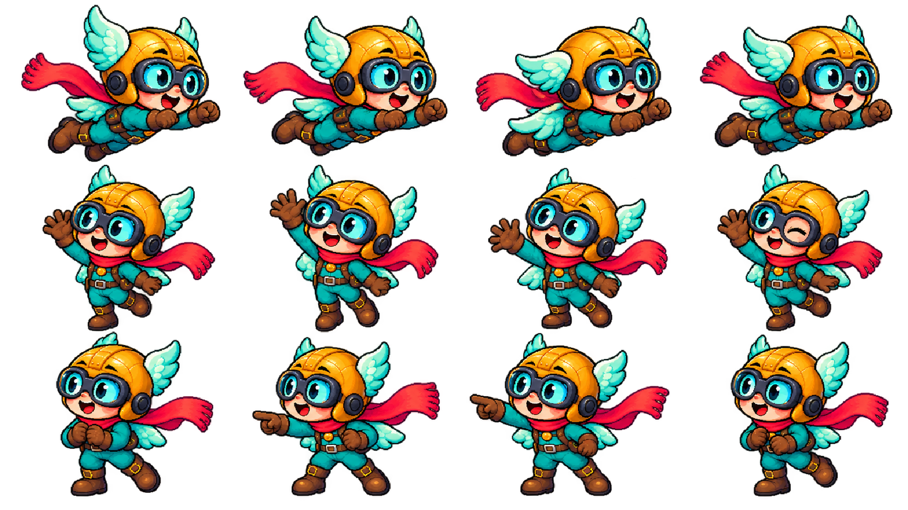

# Pico v2 — animação corporal 3

O desenho aprovado do Pico v2 permanece como identidade. Emanuel pediu mais movimento no episódio 009, sobre El Niño. A nova folha contém doze quadros corporais em 16:9.

- Primeira sequência: voo, com asas, pernas e cachecol em fases distintas.
- Segunda sequência: aceno, com movimento de membros, expressão e piscada.
- Terceira sequência: apontar, estender e recolher o braço.

Usar os ciclos com trajetórias ligadas ao roteiro: acompanhar o vento, cruzar o esquema, mergulhar, fazer curvas, chegar a um elemento, apontar e reagir. Atualizar posições em 24 fps e manter o personagem completo dentro da moldura e acima dos créditos. Preservar a leitura dos títulos e das informações essenciais. A folha é extraída por componentes conectados, com alinhamento dos quadros e exclusão de fragmentos de sprites vizinhos.

[Implementação](../../videos/ep-009-el-nino/producao/pico_animation.py) · [Direção de arte e prompts](../../videos/ep-009-el-nino/producao/art_direction.json) · [Episódio 009](../../videos/ep-009-el-nino/PUBLICAR.md) · [Design v2](Pico_v2.md)
