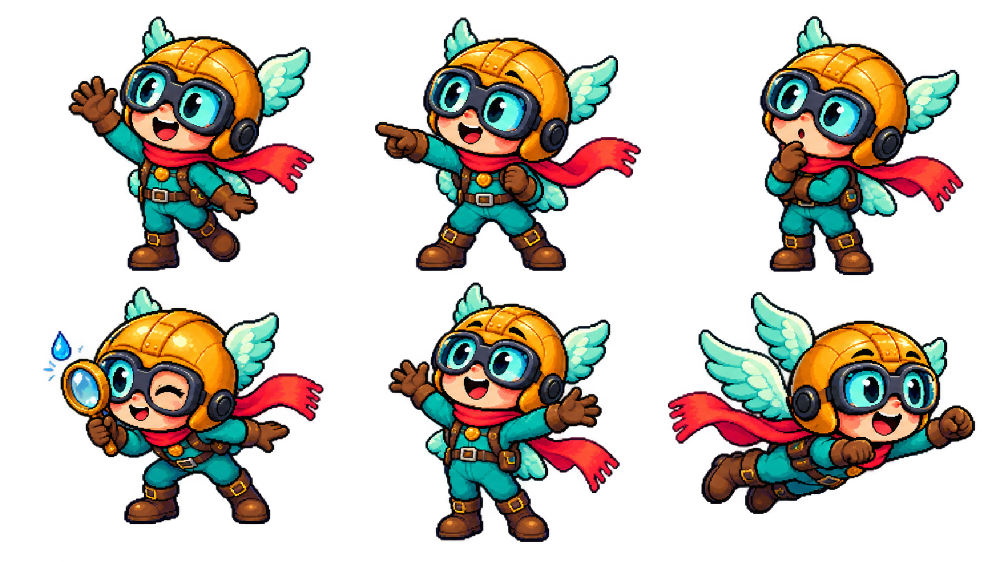

# Pico v2 — referência para os próximos vídeos

O design foi aprimorado no episódio 005 a pedido de Emanuel. Capacete dourado, óculos verde-água, traje turquesa, cachecol coral e asas continuam identificando o mesmo explorador.

A nova referência traz olhos expressivos, proporções coerentes, contornos definidos, volume, dobras na roupa e detalhes no capacete. Há seis poses: acenar, apontar, pensar, investigar com lupa, reagir a uma descoberta e voar. As poses isoladas em 16:9 estão no pacote do episódio.

Nos próximos vídeos, usar a imagem como referência de identidade e manter a coerência de proporções, rosto e paleta. O Pico deve investigar, apontar e reagir, com movimento nas cenas. Os cenários devem acompanhar a qualidade do personagem, com textura, profundidade, luz e animação.

A prancha tem fundo transparente e proporção 16:9. Foi criada com a ferramenta integrada imagegen; o prompt está em [pico_prompt.txt](../../videos/ep-005-chuva/producao/pico_prompt.txt). Os diagramas científicos continuam construídos em código, com rótulos corretos e escala indicada.

[Ver o episódio 005](../../videos/ep-005-chuva/PUBLICAR.md) · [Identidade do canal](../canal.md)
