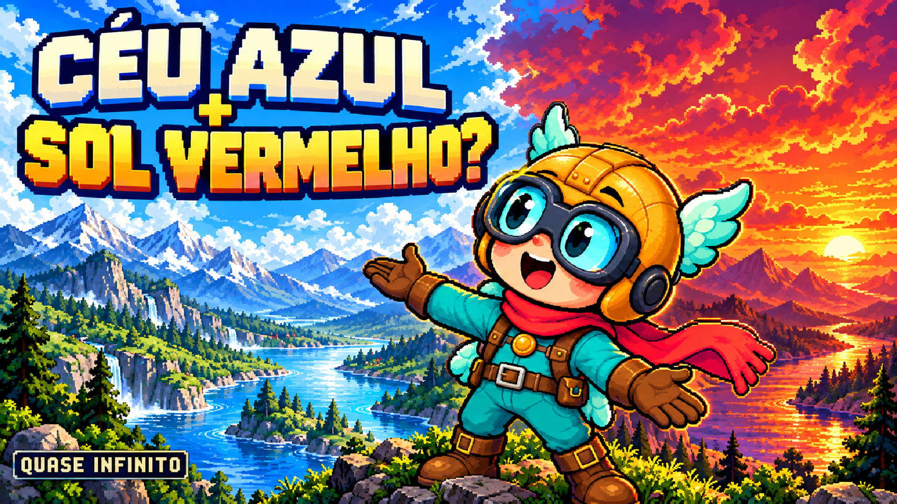

# Pronto para publicar — episódio 006

**Por que o céu é azul, mas o pôr do sol é vermelho? | Quase Infinito**

8min12s · Full HD · 16:9 · 24 fps · voz Thalita · Pico v2 · sem legendas na tela

- [Baixar vídeo completo](https://raw.githubusercontent.com/emanoelb5-lgtm/Projeto-criador-solo-/main/videos/ep-006-ceu/video.mp4)
- [Baixar pacote de publicação](https://raw.githubusercontent.com/emanoelb5-lgtm/Projeto-criador-solo-/main/videos/ep-006-ceu/publicacao.zip)
- [Miniatura JPG](miniatura.jpg) · [Miniatura PNG](miniatura.png)
- [Título](titulo.txt) · [Descrição com capítulos e créditos](descricao.txt)
- [Transcrição opcional](legendas.srt) · [Metadados](metadata.json)

Envie o MP4 ao YouTube Studio, copie título e descrição e use a miniatura JPG. O vídeo contém somente vídeo e áudio e não usa legendas na tela. O SRT separado é uma transcrição opcional. Defina público, visibilidade e horário no seu canal.

O ZIP reúne os materiais de publicação, a voz sem trilha, os segmentos de narração, os cenários, o Pico v2, os prompts e o projeto de edição. As orientações do YouTube foram usadas nas decisões de qualidade; o episódio responde à pergunta sobre o céu e o pôr do sol. Emanuel faz a publicação manual.

[Verificação](qa.json) · [Roteiro](roteiro.md) · [Fontes](fontes.md) · [Decisões editoriais](decisoes-editoriais.md) · [Produção](producao/README.md)

SHA-256 do MP4: 957a0c99286843e7df27aed8d5f63c25224781e970ba9a898dce5979b8d63912
